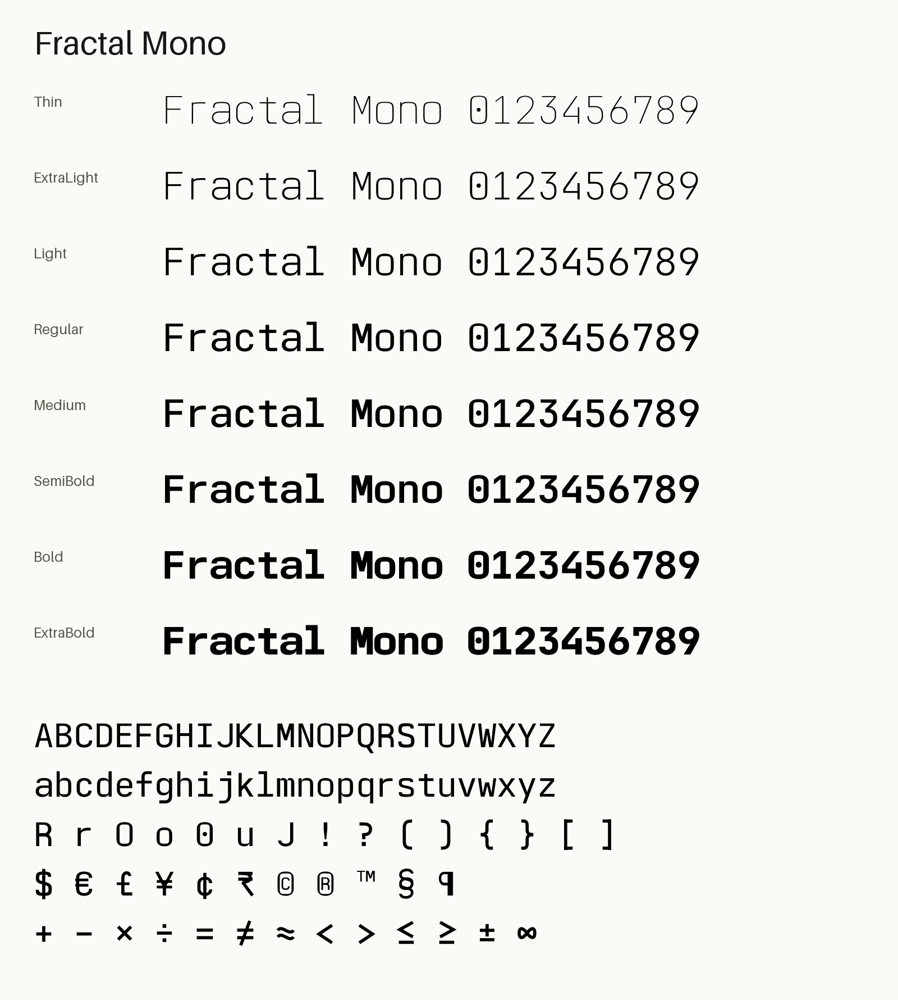

# Fractal Mono

A monospaced typeface designed by Claudia Nathan. Eight weights, from Thin to ExtraBold, with optical sizes for text and display.



## Fonts

| Folder | Contents |
| --- | --- |
| `fonts/otf` | Eight static OTF fonts |
| `fonts/variable` | One variable TTF with weight and optical-size axes |
| `fonts/webfonts` | The static and variable fonts as WOFF2 |

Install either the static OTFs or the variable TTF. They share the family name **Fractal Mono**.

Weight runs from 100 to 800. Optical size runs from 9 to 72, with a default of 14. The fonts contain 1,755 glyphs and 1,372 characters covering Latin, Greek, Cyrillic, symbols, box drawing and Powerline.

## Web

Copy `fonts/webfonts` and `fractal-mono.css` into your project:

```html
<link rel="stylesheet" href="fractal-mono.css">
<p class="fractal-mono">The quick brown fox jumps over the lazy dog.</p>
```

Add `fractal-mono-optical` for automatic optical sizing, or `fractal-mono-ligatures` for programming ligatures.

The default `O` and `o` are dotless; zero is dotted. Character variants, stylistic sets, fractions, superiors and inferiors are available through OpenType controls. Programming ligatures are optional.

## Build

Python 3.12 or newer:

```sh
python3 -m venv .venv
.venv/bin/python -m pip install -r requirements.txt
.venv/bin/python build.py
```

This writes the fonts, CSS, specimen and checksums, plus a ZIP in `dist/`. Use `build.py --check` to run the tests. Browser checks use `npm ci`, `npx playwright install chromium`, then `npm run test:browser`.

Editable masters and feature rules live in `sources/`. Build reports, local proofs and recovery material are excluded from Git.

## License

[SIL Open Font License 1.1](LICENSE.txt). Existing copyright notices are retained.
