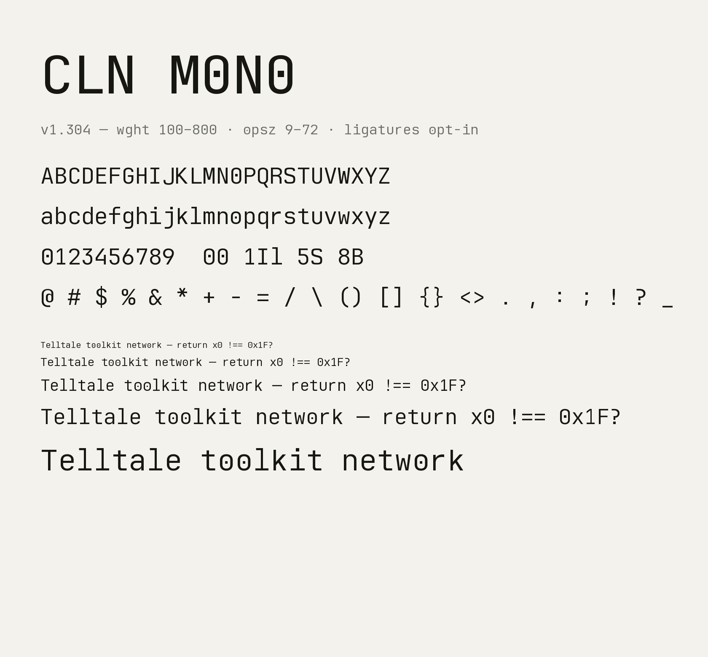

# CLN Mono

CLN Mono is a crisp monospaced typeface for code, interfaces, technical writing, and graphic work. It has a slightly brutalist construction, open counters, square punctuation, and an invariant `579`-unit cell that keeps text sitting cleanly on the line.



## Family

| Axis | Range | Default |
| --- | ---: | ---: |
| Weight (`wght`) | 100–800 | 400 |
| Optical size (`opsz`) | 9–72 | 14 |

The Text optical master raises the x-height, strengthens small details, and opens dense joins. The Display master lowers the x-height and tightens the drawing for larger settings. Cap height and advance width remain fixed throughout.

- 1,743 glyphs and 1,363 encoded characters
- Latin, Greek, Cyrillic, symbols, and code-oriented alternates
- Nine named weights from Thin to ExtraBold
- 150 optional programming-ligature drawings under `dlig`
- Character variants, fractions, superiors, inferiors, slashed zero, and tabular numerals
- Square dots across `i`, `j`, punctuation, combining marks, and dotted counters
- Upright roman; no synthetic italic

The signature set includes the hooked `J/j`, bridged `K`, compact `R/r`, open `M`, pinched `W`, compact `S`, and angular `! ? ^ ; : *`. Thin and ExtraBold use dedicated compatible masters that preserve counters, apertures, and stroke balance.

## Files

- `fonts/desktop/CLNMono-Variable.ttf` — variable desktop font
- `fonts/desktop/CLNMono-*.ttf` — nine static desktop weights at optical size 14
- `fonts/web/CLNMono-Variable.woff2` and `.woff` — variable web fonts
- `fonts/web/CLNMono-*.woff2` and `.woff` — static web fonts
- `cln-mono.css` — web setup with automatic optical sizing
- `specimen.html` — interactive tester, glyph set, OpenType features, and release data
- `ligature-audit.html` — every programming sequence, shaped and literal
- `build-report.json` — release metrics, file sizes, and SHA-256 hashes

## Install

On macOS, install `fonts/desktop/CLNMono-Variable.ttf` in Font Book. Install either the variable font or the static family, not both.

For the web:

```css
@font-face {
  font-family: "CLN Mono";
  src: url("./fonts/web/CLNMono-Variable.woff2") format("woff2") tech("variations");
  font-style: normal;
  font-weight: 100 800;
  font-display: swap;
}

code {
  font-family: "CLN Mono", monospace;
  font-optical-sizing: auto;
  font-variant-ligatures: none;
}
```

Use `font-weight` for weight and let `font-optical-sizing: auto` follow the rendered size. To lock a specific optical drawing:

```css
.display {
  font-optical-sizing: none;
  font-variation-settings: "opsz" 72;
}
```

Programming ligatures are literal by default. Enable them explicitly with `font-variant-ligatures: discretionary-ligatures`.

## Build

Python 3.11+, FontTools, NumPy, Brotli, Pillow, HarfBuzz, and Node.js are required.

```sh
make setup
make build
make test
make specimens
make release
```

The build is self-contained. Its OFL upstream binary and compatible signature-master source are stored in the repository with recorded checksums. `make test` checks all 30 font files, both variation axes, shaping, fixed cells, interpolation, contour integrity, square dots, stroke balance, extreme-weight bounds, metadata, and release hashes.

## Scope

CLN Mono 1.304 is an upright family with weight and optical-size variation. It does not include a true italic, width axis, purpose-built Windows hinting, or editorial verification for every detected language profile.

## Licence

Copyright 2026 Claudia Nathan.

CLN Mono is available under the [SIL Open Font License 1.1](OFL.txt). Required notices for inherited OFL components are retained in the licence and font metadata.
