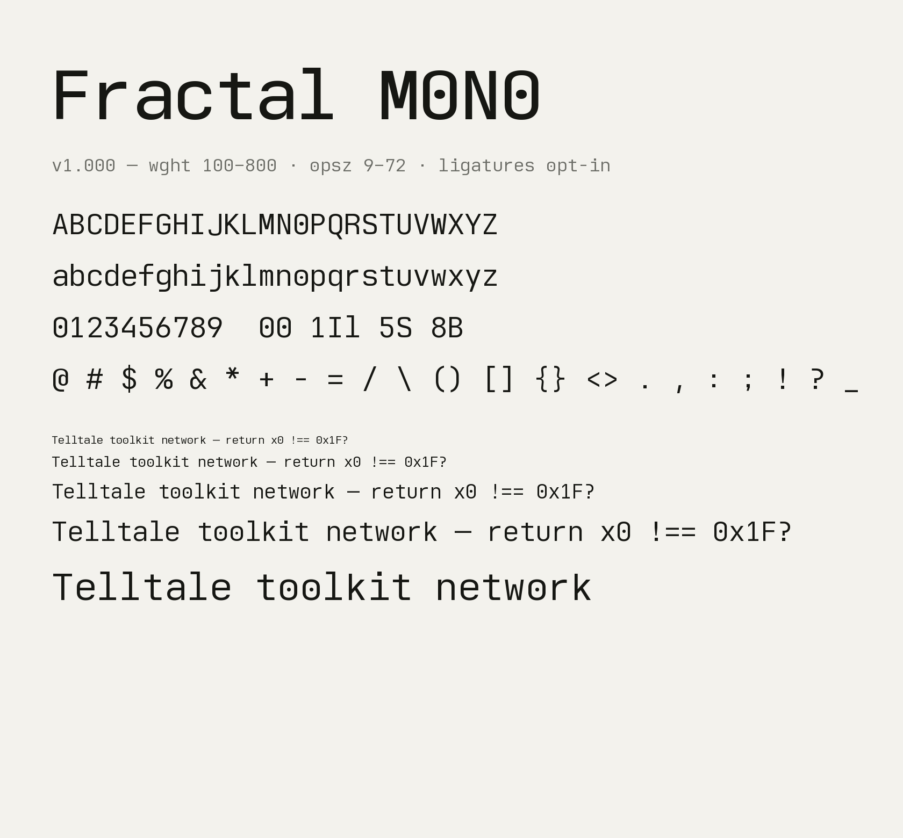

# Fractal Mono

A monospaced typeface for code, interfaces, and technical writing. Gently
brutalist construction, open counters, square punctuation, and a `579`-unit
normal-width cell that keeps text sitting cleanly on the line.

Designed by Claudia Nathan. Free to use, under the SIL Open Font License 1.1.



## Family

| Axis | Range | Default |
| --- | ---: | ---: |
| Weight (`wght`) | 100–800 | 400 |
| Width (`wdth`) | 85–115 | 100 |
| Optical size (`opsz`) | 9–72 | 14 |

Nine named weights: Thin, ExtraLight, Light, Regular, Book, Medium, SemiBold,
Bold, ExtraBold. Their control stems progress in nearly even absolute increments:
32 units at Thin, 80 at Regular, and 150 at ExtraBold. The accepted Regular range
is preserved while the light and heavy endpoints use dedicated optical
corrections.

Width changes the cell from 492 units at Condensed to 666 at Expanded, with 579
at Normal. Every instance remains strictly monospaced; the outlines use compatible
width masters with stroke compensation rather than horizontal scaling.

Optical size is its own design axis, not display scaling. The Text end raises the
x-height, enlarges the dots, and opens dense joins for small sizes; the Display end
lowers the x-height and tightens the drawing. Cap height and vertical metrics hold
constant across all three axes. Optical size and weight do not change the cell.

- 1,747 glyphs, 1,363 encoded characters
- Latin, Greek, Cyrillic, symbols, box drawing, and Powerline
- 150 programming ligatures, drawn but off by default
- Character variants, dotless counters, tabular figures, fractions, superiors and
  inferiors

The signature set is the hooked `J j`, bridged `K`, compact `R r`, open `M`,
pinched `W`, compact `S`, and the angular `! ? ^ ; : *`. Dots on `i`, `j`,
punctuation and combining marks are exact squares; the counter dots in `O`, `o`
and `0` are circles. Diagonals are held to the family's stroke system at every
weight rather than left to interpolation. The heavy `C G M N S` follow Claudia
Nathan's silhouette references through compatible point deltas, and round control
strokes reach about 1.03 times the straight stem without closing their counters.

The default colon is centred for lowercase. Its `case` form uses the same square
dots raised to the cap centre, and contextual alternates select that position
between capitals or lining figures. The semicolon begins from the same colon
geometry before tapering into its comma tail.

## Install

**Desktop.** Install `fonts/desktop/FractalMono-Variable.ttf` for the whole axis
range, or the nine static faces in the same folder. Do not install both formats at
once: applications can hide duplicate named weights. Use the static faces in
design tools that clamp variable weights or omit a named instance.

**Web.** Copy `fonts/web/` and `fractal-mono.css` into your project, or set it up
directly:

```css
@font-face {
  font-family: "Fractal Mono";
  src: url("./fonts/web/FractalMono-Variable.woff2") format("woff2") tech("variations");
  font-style: normal;
  font-weight: 100 800;
  font-stretch: 85% 115%;
  font-display: swap;
}

code, pre, kbd {
  font-family: "Fractal Mono", ui-monospace, monospace;
  font-stretch: 100%;
  font-optical-sizing: auto;
  font-variant-ligatures: none;
}
```

One request covers the whole range. Use `font-weight` for weight,
`font-stretch` for width, and let `font-optical-sizing: auto` follow the rendered
size:

```css
.condensed {
  font-stretch: 85%;
}

.expanded {
  font-stretch: 115%;
}

.display {
  font-optical-sizing: none;
  font-variation-settings: "opsz" 72;
}
```

**Editors and terminals.** Set the family to `Fractal Mono`. Some terminals
rasterise each glyph into a fixed cell without subpixel positioning, so the Thin
face can soften below about 13px. A slightly larger size or a middle weight holds
up better there than the same settings would in an editor.

## Features

Programming ligatures are drawn but **off by default**, so source stays literal
and cursoring stays predictable — every sequence keeps one advance per character.
Turn them on explicitly:

```css
code { font-variant-ligatures: discretionary-ligatures; }
```

| Feature | What it does |
| --- | --- |
| `dlig` | 150 programming ligatures, off by default |
| `ss03` | Dotless `O`, `o`, `0` — the dotted forms are the default |
| `cv01`–`cv20`, `cv99` | Character variants |
| `tnum`, `frac`, `sups`, `subs`, `zero` | Figures and fractions |

Longer repeated sequences are guarded, so a four-character run of the same
character stays literal even with `dlig` on.

## Files

- `fonts/desktop/` — variable font plus nine normal-width statics at optical size 14
- `fonts/web/` — the same as `woff2` and `woff`
- `fractal-mono.css` — web setup with automatic optical sizing
- `specimen.html` — interactive tester, glyph set, features, release data
- `ligature-audit.html` — every programming sequence, shaped and literal
- `build-report.json` — release metrics, file sizes, SHA-256 hashes

## Build from source

Python 3.9+ and Node (for the browser-rendered proofs).

```sh
make setup      # install Python and Node dependencies
make build      # build every desktop and web artefact
make validate   # run the metadata, geometry, and width-axis suites
make specimens  # regenerate proofs and specimen images
make release    # build, test, and package an archive
```

Builds are byte-reproducible — the same source produces the same bytes, so a
release hash identifies the outlines rather than the moment of the build.

The upright is transformed from JetBrains Mono 2.304, which supplied the initial
character set and OpenType scaffolding. The design, metrics, stroke system, and
drawings are original. `source/DESIGN_NOTES.md` covers the architecture;
`source/stroke_system.py`, `source/drawings.py`, and `source/key_symbols.py` hold
the geometry the family's own rules are enforced through.

Three suites gate a release. `source/validate.py` checks metadata, axes, metrics,
advances, features, and shaping across the axis grid. `source/validate_geometry.py`
samples 29 weights against 3 optical sizes for self-intersection,
diagonal-to-stem proportion, ink monotonicity, cell containment, dot squareness,
and counter-dot centring. `source/validate_width.py` checks 315 compiled instances
for width-dependent advances, stroke stability, vertical invariance, topology,
cell containment, mark attachment, and shaping.

## Not in this release

No italic or oblique, and no purpose-built Windows hinting. The
outlines request grayscale smoothing; applications will synthesise an oblique
from the upright if asked for one.

## Licence

Licensed under the [SIL Open Font License 1.1](LICENSE.txt), with the Reserved
Font Name **Fractal Mono**.

In plain terms: use it for anything, personal or commercial, bundle it with your
software, embed it in a document, and modify it. Two conditions. Keep the
copyright and licence notice with it. And if you modify it, release your version
under a different name — the reserved name stays with the original, so "Fractal
Mono" always means this font.

## Credits

Designed and built by Claudia Nathan.

- [JetBrains Mono](https://github.com/JetBrains/JetBrainsMono) 2.304 by the
  JetBrains Mono Project Authors — the source master the upright is transformed
  from. SIL Open Font License 1.1.
- [Whois Mono](https://github.com/raphaelbastide/Whois-mono) by Raphaël Bastide —
  the lowercase `r` construction. SIL Open Font License 1.1.

Both notices are reproduced in full in [LICENSE.txt](LICENSE.txt).
